=======================
tcs-xtcee User Manual
=======================

.. contents:: Contents
   :depth: 2
   :local:

.. note::

   This is a very early release of tcs-xtcee. Comments are very welcome,
   as are people interested in collaborating on it. Please open an issue
   or a pull request at https://github.com/vomlehn/tcs-xtce; the
   contributing guide,
   https://github.com/vomlehn/tcs-xtce/blob/main/CONTRIBUTING.md, says
   how.

Introduction
============

``tcs-xtcee`` is a graphical editor for XTCE documents.  It holds a
document to the XTCE version it is written in: XTCE 1.1, 1.2 or 1.3,
each checked against the schema OMG published for it.  It changes a
document only where it is edited, so a file it saves differs from the
file it opened only in what was changed: comments, blank lines,
indentation, quoting and the order of attributes are kept as written,
and a comment stays where it was put when the elements around it are
edited, moved or deleted.

XTCE 1.0 is not one of the versions: its schema was published only
inside its specification, never in a form a program can read.

Building it
===========

.. code-block:: sh

   make editor                  # builds it
   editor/target/release/tcs-xtcee FILE...

The tcs-xtce package installs it as ``/opt/tcs/bin/tcs-xtcee``,
already built, with the Python package it uses installed beside it.

The packet layout, the encode and decode window and the compiler's
check use the Python package, as `Running the compiler
<tcs-xtce.html#running-the-compiler>`__ describes: from a checkout, run
``make generate`` first, or set ``TCS_XTCE_PYTHONPATH`` to the directory
that holds ``tcs_xtce``.

OMG's files
===========

The editor holds each document to the schema OMG published for its XTCE
version, and opens OMG's specification at an element.  OMG does not allow
either to be redistributed, so neither is built into the editor or
packaged with it.  Each is downloaded from OMG, with ``curl``, the first
time it is needed, and only once you have agreed:

* a version's schema when a document of that version is opened or made,
  or a document is converted to it;
* a version's specification when Tools > Specification of this element
  asks for it.

The editor asks in a dialog, saying what is to be downloaded, from where
and to where; Cancel downloads nothing and leaves the document unopened,
and the status line says how to download the file yourself.  The
commands (`From the command line`_) ask on the terminal, and without a
terminal, as in a Makefile or a CI job, download nothing and stop, unless
given ``--download``.

What is downloaded is kept in ``~/.local/share/tcs-xtcee/``
(``$XDG_DATA_HOME/tcs-xtcee`` if set), as ``xtce-1.3.xsd`` and
``XTCE-1.3.pdf`` (or ``1.1``, ``1.2``), so each is asked about once.  A
file you download yourself and save there under that name is used as it
is.  In a checkout, the editor uses the copies in ``references/``
instead, which ``make test-editor`` fetches (``make -C references
editor``), so that its tests need no network and ask nothing.

Its windows
===========

``tcs-xtcee FILE...`` opens each file in a window of its own.  The files
given together are one mission (`Missions in several documents
<tcs-xtce.html#missions-in-several-documents>`__): a reference in one can
name a definition in another, and File > Open adds another document to
the mission.

Each window shows:

* the document as a tree.  An open element shows, one level deeper,
  its attributes, its value if it holds one, its comments and the
  elements in it.  Each attribute is a field one line high, which grows
  as its text wraps: marked *(required)* where the schema requires it, a
  list where the schema gives the values it may take, and with a **Go
  to** button where it is a reference.  Only the attributes an element
  gives, and those it must, are shown; the row *attribute* below them
  offers the rest, and one chosen there is put in when it is given a
  value.  An element with a problem in it is marked **E** for an error
  or **W** for a warning, on its row and on every row above it, so a
  closed row shows that something inside it is wrong, and what is wrong
  is written under the row of the element or attribute it is in, marked
  the same way.  Resting the pointer on a name shows what the schema says
  of it;
* the problems: every schema error, and, as warnings, every reference
  that names nothing in the open documents and every two definitions of
  one name.  Picking one selects the element it is about;
* a Source tab, where the document's text can be edited and applied as
  a whole.

The window's title names the file and its XTCE version, and starts with
``*`` while the document has changes that are not saved.  The pictures in
this manual are the editor's own windows, opened on the documents in
``examples/`` and drawn by ``make screenshots``.

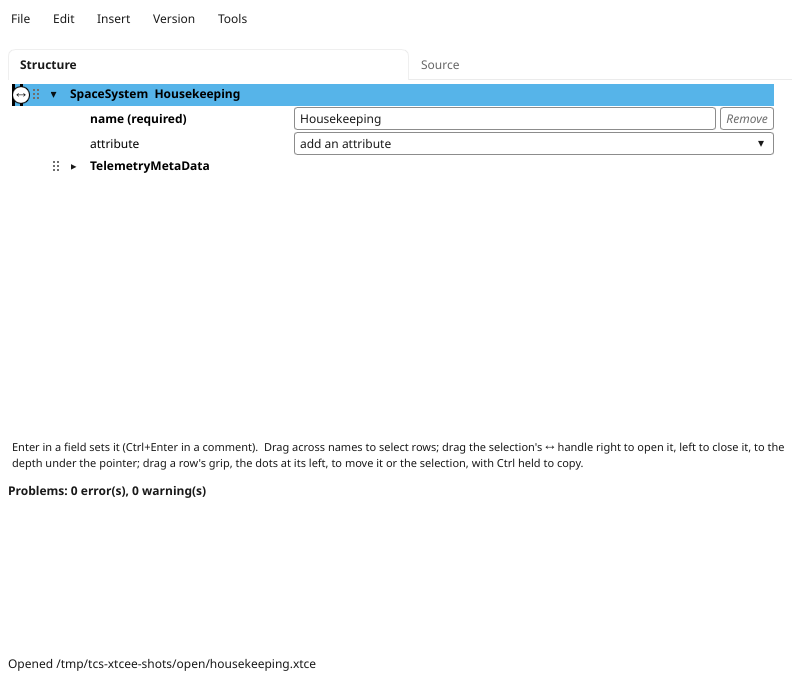
         menus File, Edit, Insert, Version and Tools; the Structure and
         Source tabs; an outline whose only open row, SpaceSystem
         Housekeeping, is selected and shows its name attribute, the row
         that adds an attribute, and the closed TelemetryMetaData; below
         it a line of hints, "Problems: 0 error(s), 0 warning(s)", and the
         status line saying which file was opened.

   ``tcs-xtcee housekeeping.xtce``: the root, SpaceSystem Housekeeping,
   is open and selected.  Its attribute ``name`` is required; the row
   *attribute* offers the others it may have.  Below the outline are the
   problems, none here, and the status line.

Selecting, opening and closing
==============================

A click on a name selects its row, which the Edit and Insert menus act
on; Ctrl+click adds a row to the selection or takes it out, and
Shift+click selects every row from the selected one to it.  Dragging
across names selects every row dragged across, Ctrl added to those
already selected; dragged past the top or the bottom, the tree scrolls,
faster the further past the pointer goes.

The selection is marked by its rows' colour and by a line down the
column where its topmost element starts, with a ↔ handle at the middle
of the part of the line in view.  Dragging the handle opens or closes
every selected element, and everything in it, to the depth whose column
the pointer is let go over; the line follows the pointer, and words
beside it say what letting go will do.  Dragged right, it opens each
element less deep than that, so that the rows down to that depth are
shown, and leaves open what is open.  Dragged left, it closes each
element as deep or deeper, so that none deeper is shown, and leaves
closed what is closed.  Elements outside the selection are not changed.
The triangle beside a name opens or closes that element alone.

Finding your way round a document
---------------------------------

A first look round ``housekeeping.xtce``, from the window it opens in:
opening the outline a few levels at once, reading what the schema says
of an element, and following a reference to what it names.

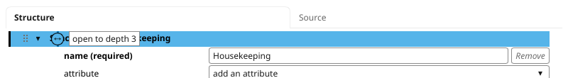
         columns right of the line marking the selection, and beside it a
         box saying "open to depth 3".

   **1.** The ↔ handle of the selection, the root, dragged right: the words
   beside it say what letting go will do.

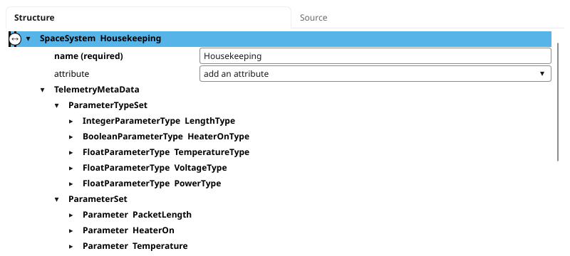
         ParameterTypeSet and ParameterSet, and in them five types and
         five parameters, each closed.

   **2.** Let go, the selection is opened so that the rows down to depth
   3 are shown: the root is depth 0, so the types and the parameters.

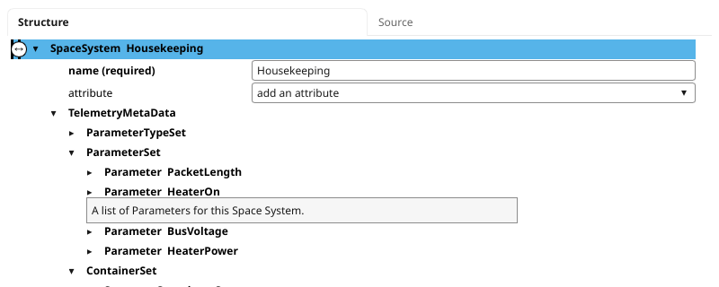
         ParameterSet a box saying "A list of Parameters for this Space
         System."

   **3.** ParameterTypeSet closed with the triangle beside it, and the
   pointer resting on the name ParameterSet, which shows what the schema
   says of it.

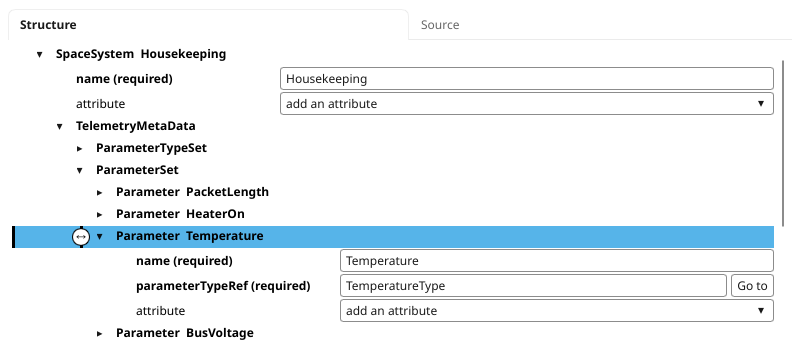
         name, Temperature, and parameterTypeRef, TemperatureType, both
         marked required, with a Go to button beside parameterTypeRef,
         and the row that adds an attribute.

   **4.** Parameter Temperature opened with its triangle and selected with a
   click on its name.  ``parameterTypeRef`` is a reference, so it has a **Go
   to** button.

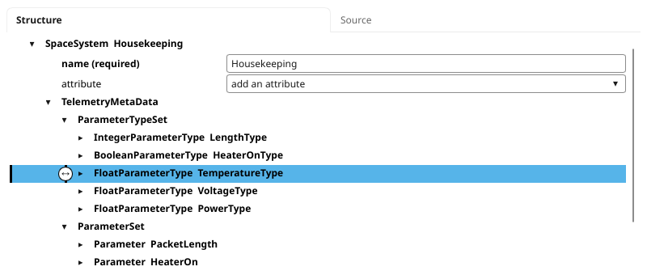
         TemperatureType selected in it.

   **5.** **Go to** selects the type the reference names, FloatParameterType
   TemperatureType, opening the rows above it.

Editing a value
===============

An attribute's field is edited in place, and Enter sets it (Ctrl+Enter in
a comment, whose Enter starts a new line); until then, nothing is
changed.  Setting it is a change, which is checked as every change is
(`Changes the version does not allow`_).

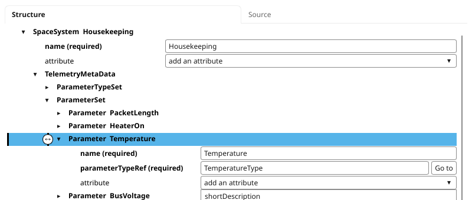
         attribute" row dropped down, offering shortDescription and
         initialValue.

   **1.** The list on the row *attribute* of Parameter Temperature offers
   the attributes the schema allows that it does not give.

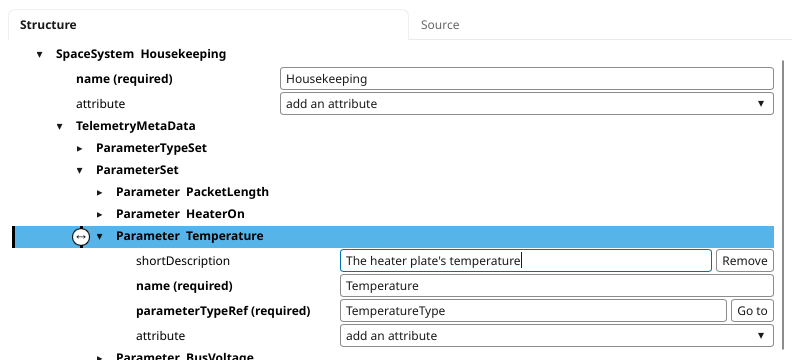
         the parameter's name, holding the text "The heater plate's
         temperature" with the text cursor at its end.

   **2.** ``shortDescription`` chosen: an empty field for it, typed in.

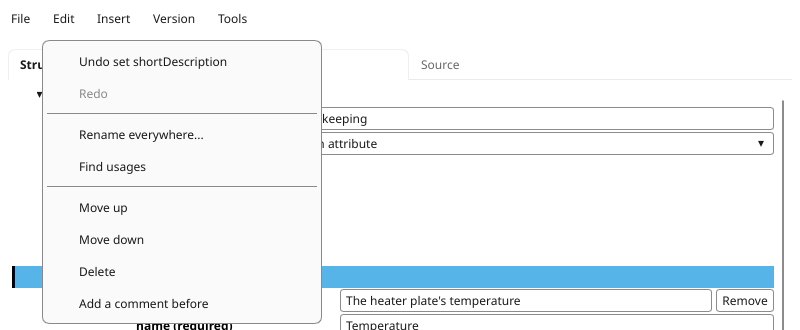
         behind it the field holds the text.

   **3.** Enter sets it: the change is taken, and Edit > Undo names it.
   The attribute's name is now in bold, as the names of those the
   element gives are.

Changes the version does not allow
==================================

Every change is held to the document's version.  An attribute set to a
value its type does not allow, an element put where the schema does not
allow it, a required element or attribute taken out, a source edit that
breaks the schema: each is refused, the document is left as it was, and
the status line says why and what the schema wants.  A document opened
with errors can be corrected a change at a time, but no change may make
it worse.

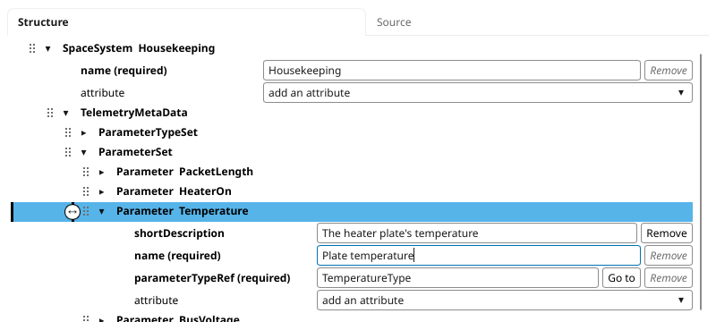
         temperature", typed but not yet set.

   **1.** A name with a space in it typed into the parameter's ``name``.

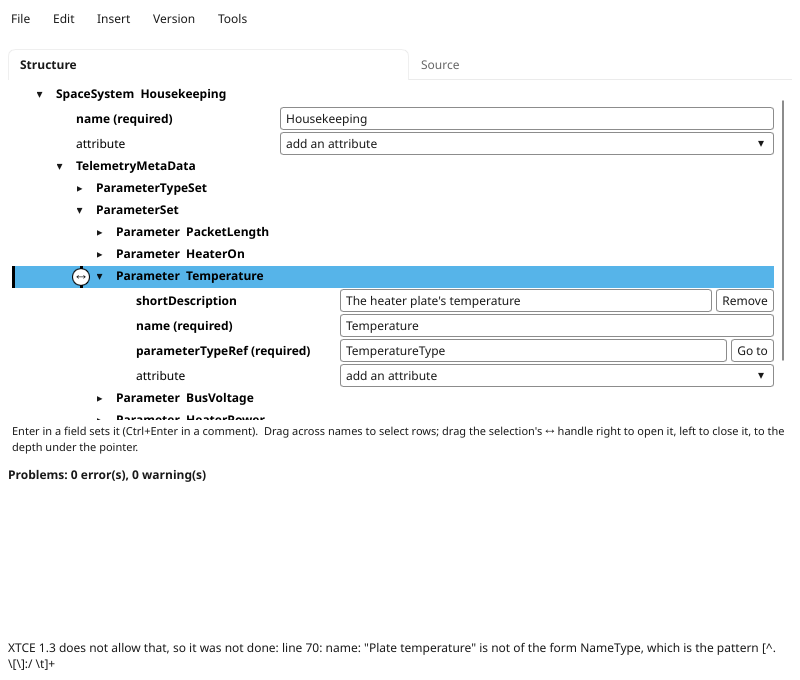
         again, and the status line says "XTCE 1.3 does not allow that,
         so it was not done: line 70: name: "Plate temperature" is not of
         the form NameType", with the pattern NameType requires.

   **2.** Enter: XTCE 1.3 does not allow a space in a name, so the change is
   refused.  The field shows the name as it was, and the status line says
   why, with the pattern the schema's NameType requires.

So that nothing is ever put in half-made, Insert offers only the
elements the schema allows in the selected element, and each is made
complete: with its required attributes, each given a value of the right
kind, and the fewest children that complete it.  Ready-made parts are
offered where they fit: integer, float and boolean types in a
ParameterTypeSet, and in a SpaceSystem the six-byte primary header of a
CCSDS space packet (CCSDS 133.0-B), with its types, its parameters and
the abstract container a packet builds on.

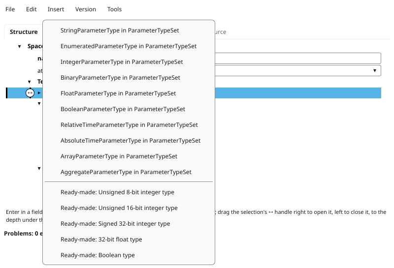
         StringParameterType, EnumeratedParameterType,
         IntegerParameterType and the other parameter types "in
         ParameterTypeSet", then five ready-made parts: unsigned 8-bit
         and 16-bit integer types, a signed 32-bit integer type, a 32-bit
         float type and a Boolean type.

   **1.** ParameterTypeSet selected: Insert lists what may go in it, and
   below them the ready-made parts that fit.

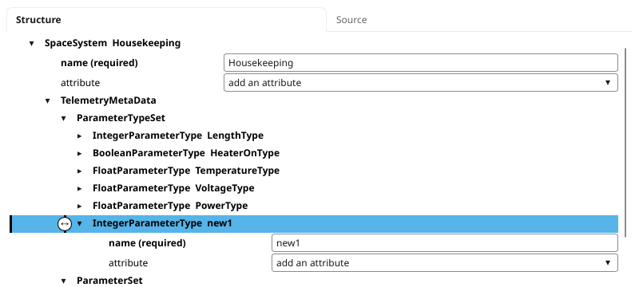
         ParameterTypeSet and open, showing its required name, new1; the
         line marking the selection, with its handle, is beside it, and
         ParameterTypeSet is no longer selected.

   **2.** IntegerParameterType chosen: one is put in, complete, its required
   ``name`` given a value of the right kind, and selected in place of
   ParameterTypeSet.

Problems in a document
======================

The problems list is drawn again after every change, and a click on a
problem selects the element it is about, opening the rows above it.  The
pictures are of a copy of ``housekeeping.xtce`` with two mistakes put in
it: a coefficient that is not a number, and a parameter whose type is
named ``PowrType``, which nothing defines.

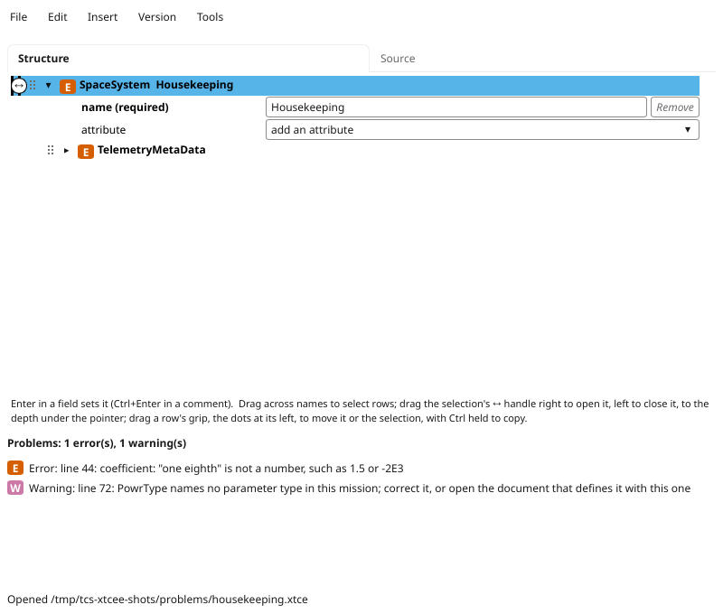
         closed TelemetryMetaData marked E; the problems list titled
         "Problems: 1 error(s), 1 warning(s)", an error marked E on line
         44, "coefficient: "one eighth" is not a number", and a warning
         marked W on line 72, "PowrType names no parameter type in this
         mission".

   **1.** Opened: the list gives each problem with its line, an error marked
   **E** and a warning **W**, and every row above a problem carries the
   worse mark, closed or not.

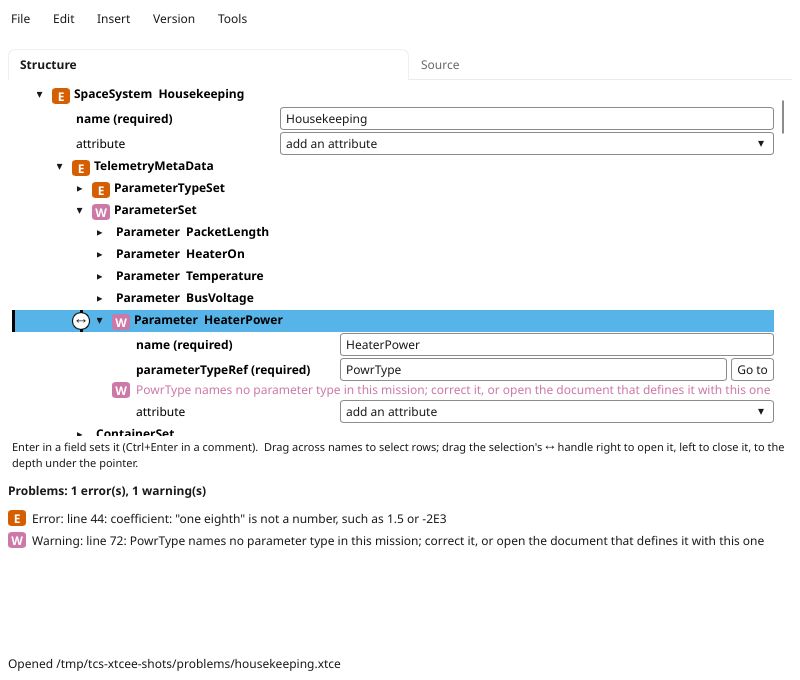
         is selected and open, and under its parameterTypeRef, which
         holds PowrType, the problem's text is written, marked W.

   **2.** A click on the warning selects Parameter HeaterPower; opened, it
   shows the problem under the attribute it is about, marked **W** as a
   warning, as it is in the list.

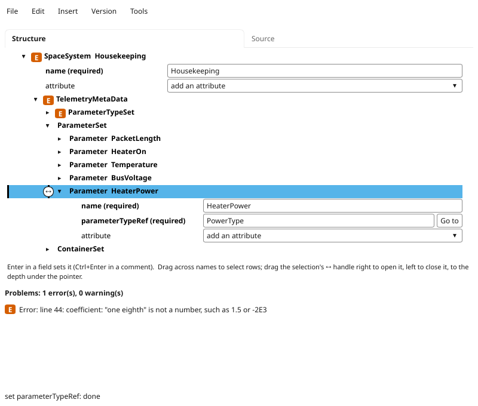
         list titled "Problems: 1 error(s), 0 warning(s)" holding only
         the error on line 44.

   **3.** ``PowerType`` typed in its place and Enter pressed: the warning is
   gone, from the list and from the rows.

Undo and redo
=============

Edit > Undo and Redo name the change they undo or redo.  Each document
has a history of its own.  A rename across documents -- Edit > Rename
everywhere, which renames a definition and every reference to it in the
open documents -- is one step in each document's history, and is undone
in all of them at once, when it is the last change in each.  The
histories are kept only while the editor runs: they are gone when it is
closed.

Saving, autosave and recovery
=============================

The editor looks at its documents once a second, and does what is
below once two seconds have passed since the last change: so two to
three seconds after it.

With autosave on, a changed document is then written to its file.
File > Autosave turns it off and on, and the setting is kept in
``~/.config/tcs-xtcee/settings`` (``$XDG_CONFIG_HOME`` if set).  With it
off, a changed document that has not been saved is kept in a recovery
copy in ``~/.local/state/tcs-xtcee/`` (``$XDG_STATE_HOME`` if set), so
that a crash loses at most the last seconds; the next time the document
is opened, the editor offers the copy's changes, which Undo then takes
back if they are not wanted.  Saving removes the copy.

Autosave on or off, a document never yet saved -- one made with File >
New document -- has no file to write over, so it gets a recovery copy
until File > Save writes it; so does a document whose file another
program has changed, until you choose what to do (below).

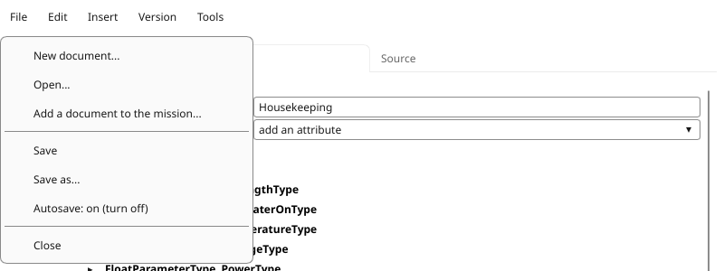
         mission, Save, Save as, "Autosave: on (turn off)" and Close.

   File > Save writes the document now; the item below Save as says
   whether autosave is on, and turns it off or on.

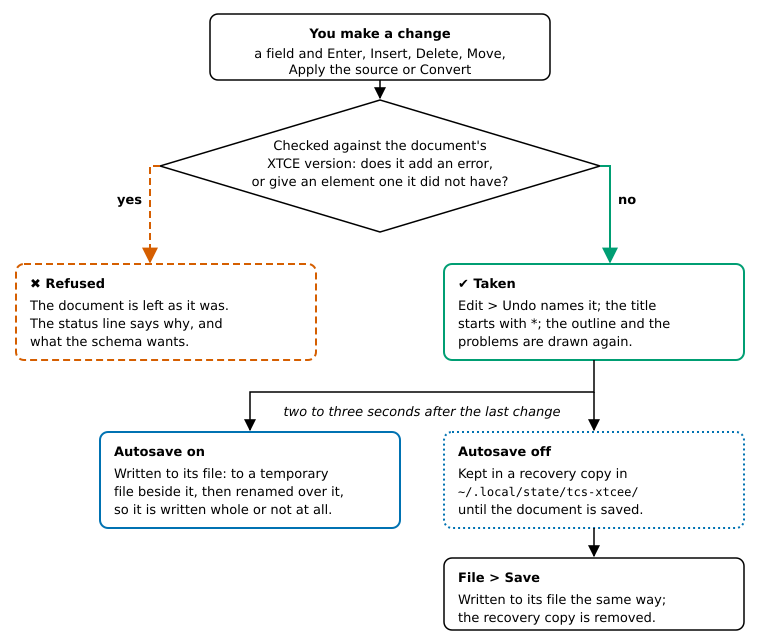
         Move, Apply the source or Convert -- is checked against the
         document's XTCE version.  If it adds an error, or gives an
         element one it did not have, it is refused, shown by a dashed
         vermillion box with a cross: the document is left as it was and
         the status line says why.  Otherwise it is taken, shown by a
         solid bluish green box with a tick: Edit > Undo names it, the
         title starts with *, and the outline and problems are drawn
         again.  Two to three seconds after the last change, with
         autosave on, it is written to its file through a temporary file
         renamed over it; with autosave off, it is kept in a recovery
         copy in ~/.local/state/tcs-xtcee/ until File > Save writes it
         the same way and removes the copy.

   What happens to a change, from the check to the file.

A file is written whole or not at all: to a temporary file beside it,
flushed, then renamed over it.  A file changed on disk by another
program -- git, another editor -- is noticed, and the editor asks
whether to reload it, which Undo can undo, or keep its own version; it
does not write over the other change until one is chosen.

Converting between versions
===========================

Version > Convert to XTCE *version* converts the document to another
version, a version at a time, as one change that Undo undoes.  Before
anything is changed the conversion dialog lists:

* **Changed**: what is written another way in the other version, such
  as an element 1.3 renamed (``RelativeTimeAgumentType``, as 1.2 spells
  it, becomes ``RelativeTimeArgumentType``), 1.1's byte order list
  becoming 1.2's ``byteOrder`` attribute, or a default the versions read
  differently written out so that its meaning is kept;
* **Lost**: what the older version cannot say, on the way down, such as
  1.3's ``disabled`` on an alarm.  A conversion that loses anything is
  made only when the box agreeing to the loss is ticked;
* **Needed**: what the document does not hold and the other version
  requires, such as the sizes of an array's dimensions, which 1.1 does
  not give, or a DiscreteLookupList's ``defaultValue``, which 1.3
  requires.  Each is asked for in the dialog;
* **Refused**: what cannot be converted at all, with why, such as a 1.3
  unit 1.2 has no word for.

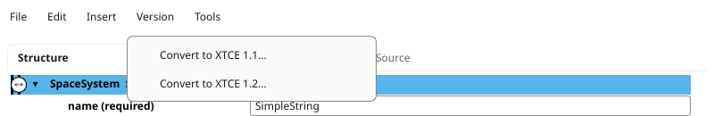
         to XTCE 1.1..." and "Convert to XTCE 1.2...".

   **1.** The Version menu offers the versions the document is not in;
   ``simple_string.xtce`` is in 1.3.

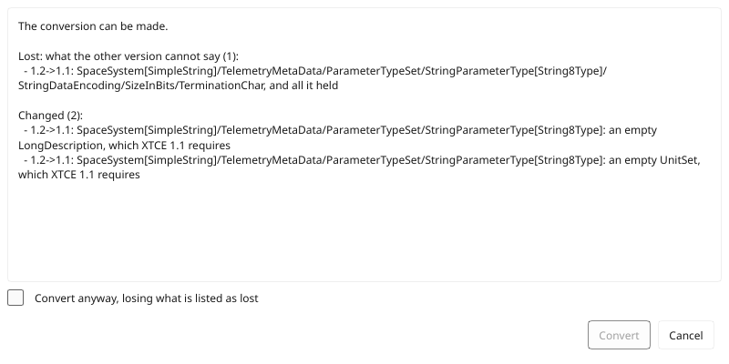
         "Lost: what the other version cannot say (1)", the
         TerminationChar of String8Type's encoding, and under "Changed
         (2)", an empty LongDescription and an empty UnitSet that XTCE 1.1
         requires; an unticked box "Convert anyway, losing what is listed
         as lost"; the Convert button, not available, and Cancel.

   **2.** Convert to XTCE 1.1, by way of 1.2: 1.1 cannot say the string's
   termination character, so Convert waits for the box agreeing to lose it.

The rules come from comparing the three schemas element by element and
attribute by attribute; the design describes them.  A converted document
is checked against its new version's schema before it is taken.

Tools
=====

Tools > Packet layout
   Draws each packet's fields to scale, each with its name and size
   written in it, as the tcs-xtce compiler lays the packet out, and shows
   the compiler's size report (`Size report <tcs-xtce.html#size-report>`__).

Tools > Encode and decode
   Encodes values given as JSON into a packet's bytes, and decodes bytes
   given in hexadecimal, with the Python codecs the compiler generates
   for the mission, so what it shows is what the generated code does.

Tools > Compare with a file
   Lists how another file differs from the document in what it means:
   comments, layout, attribute order, prefixes and the order of
   unordered sets are ignored, as the digest ignores them.

Tools > Digest
   Gives the document's digest, as ``xtce-digest`` computes it.

Tools > Specification of this element
   Opens the version's specification, searching it for the selected
   element where the PDF viewer can (Evince can), asking first to
   download it the first time (`OMG's files`_).

A mission in XTCE 1.1 or 1.2 is converted to 1.3 in memory for the
compiler's tools, which read 1.3; its files are not changed.

From the command line
=====================

The schema checking and the converting run without the windows, for a
Makefile or a CI job:

.. code-block:: sh

   tcs-xtcee check FILE...
   tcs-xtcee convert FILE --to 1.2 [--allow-loss] [--set KEY=VALUE]...
                 [-o OUT]
   tcs-xtcee sample VERSION SEED

Each takes ``--download``, which downloads a schema not yet on this
machine without asking (`OMG's files`_).  ``check`` holds each file, on
its own, to its version's schema, prints each error as
``FILE:LINE: error: ...``, and fails if there is one.  It does not look
at references: a reference that names nothing, or two definitions of one
name, is a warning in the editor, not an error, so ``check`` neither
prints it nor fails on it.  ``convert`` prints what it changed, lost, needs and
refuses; it writes nothing if anything is refused or needed, or, without
``--allow-loss``, if anything would be lost.  Each need is printed with
the ``--set`` that answers it.  ``sample`` prints a random valid document
of a version, which the tests use.

Testing
=======

``make test`` in the tcs-xtce checkout runs the editor's tests with the
rest (``make test-editor`` runs them alone): its documents, schemas,
checker, conversions and windows, the windows drawn without a display.
``make editor-check`` holds the editor to ``xmllint``: it makes random
documents of every version, converts each to every other, and has
``xmllint`` judge every document made.

License
=======

tcs-xtcee is part of tcs-xtce, and is licensed as it is: under either of
the Apache License, Version 2.0 (``LICENSE-APACHE``, or
http://www.apache.org/licenses/LICENSE-2.0) or the MIT license
(``LICENSE-MIT``, or http://opensource.org/licenses/MIT), at your option.

See Also
========

`The tcs-xtce manuals <manual.html>`__
    What each of tcs-xtce's manuals covers.

`The tcs-xtce manual <tcs-xtce.html>`__
    The code generator, the runtimes and ``xtce-digest``, which the editor's
    packet layout, encode and decode window and check use.

`The tcs-xtcee design <tcs-xtcee-design.html>`__
    How the editor works inside, and why.

`XTCE, the OMG specification <https://www.omg.org/spec/XTCE/>`__
    The Object Management Group's XML Telemetric and Command Exchange
    standard, whose versions 1.1, 1.2 and 1.3 the editor edits.
